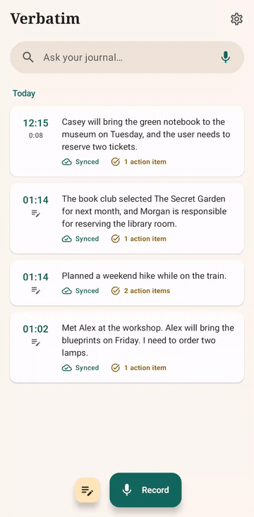
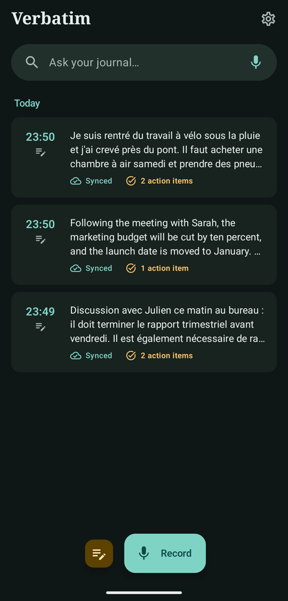
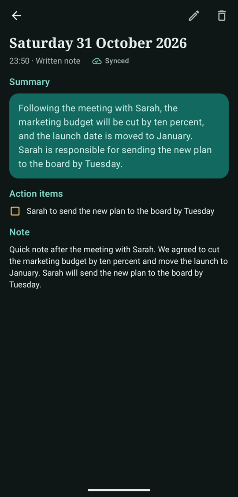
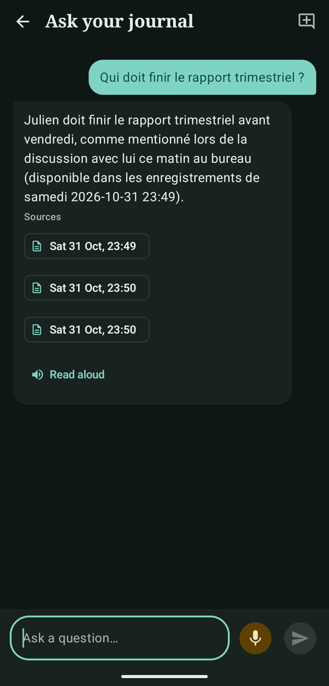
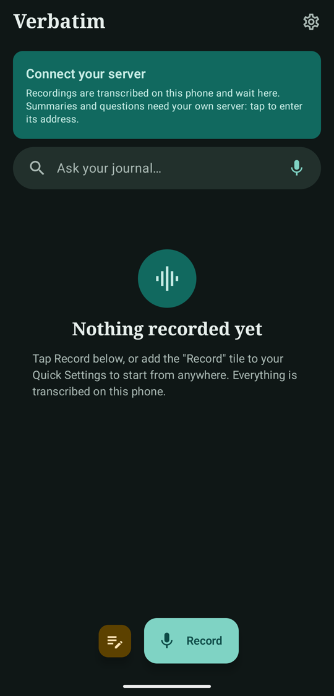

# Verbatim

A private voice journal for Android that you run yourself. Record a conversation or a note, get a transcript on your phone, a summary from your own computer, then ask questions like *"qu'est-ce que j'ai fait hier ?"* or *"who did I ask to write the report?"*.

**Your audio never leaves your phone.** Only the transcript text goes to the server, and the server is a computer you own, running an AI model you choose. There is no account, no hosted service and no cloud provider.

<p align="center">
  
</p>

*The 24-second silent demo: browse a recording's summary and timed transcript, see a spoken question answered, and open its source ([MP4 version](docs/screenshots/demo.mp4)). All demo content is invented; system bars are cropped out.*

<p>
  
  
  
  
</p>

*All content in these screenshots is invented.*

## How it works

```
 Your Android phone                         Your computer
┌───────────────────────────┐              ┌─────────────────────────────┐
│ record → .m4a stays here  │  transcript  │ server (FastAPI)            │
│ transcribe on the phone   │ ───text────► │  stores text (SQLite)       │
│ read answers aloud        │ ◄──summary── │  search index (ChromaDB)    │
│                           │ ◄──answers── │  summaries, answers ──► your│
└───────────────────────────┘              │  local model (any OpenAI-   │
        private network                    │  compatible server)         │
        (e.g. Tailscale)                   └─────────────────────────────┘
```

More detail: [docs/architecture.md](docs/architecture.md).

Your computer doesn't have to stay on. While it's off, the phone keeps recording and transcribing, and the text waits. It's sent when the app is next opened or brought to the front with the server reachable. Sync doesn't run in the background, and saved summaries stay readable, but new questions need the server.

## What you need

- An **arm64 Android phone**, Android 8 or newer. The accurate speech model uses about 1 GB of memory more while transcribing.
- A **computer for the server**: Python 3.12 or 3.13 and a local model server. The fresh dependency install and automated tests were checked with Python 3.13. A GPU with 4 GB of memory is enough for the tested model.
- A **private network** between the two, such as [Tailscale](https://tailscale.com) (free for personal use).
- Only if you build the app yourself: Android Studio, with the SDK it offers to install.

## 1. Start a model

Servers with an OpenAI-compatible `/v1/chat/completions` endpoint are candidates, including llama.cpp, llama-swap, LM Studio and Ollama. Only the route below has been exercised with this release's server; compatibility with the others is not verified.

The tested runtime is [llama.cpp b11960](https://github.com/ggml-org/llama.cpp/releases/tag/b11960), with **Gemma 4 E4B, Q4_K_M**. For Windows x64 with an NVIDIA GPU, get `llama-b11960-bin-win-cuda-12.4-x64.zip` and `cudart-llama-bin-win-cuda-12.4-x64.zip` from that release and extract both into the same folder. A compatible NVIDIA driver is required. Other hardware needs the appropriate runtime build and has not been tested here.

The 5.3 GB model is [`gemma-4-E4B-it-Q4_K_M.gguf`](https://huggingface.co/lmstudio-community/gemma-4-E4B-it-GGUF/blob/99210a71094c6aa8559f764e0cadedd7d89de94d/gemma-4-E4B-it-Q4_K_M.gguf), from `lmstudio-community/gemma-4-E4B-it-GGUF`. Read its licence, then download it yourself. In PowerShell, from the runtime folder:

```powershell
curl.exe --fail --location --output gemma-4-E4B-it-Q4_K_M.gguf https://huggingface.co/lmstudio-community/gemma-4-E4B-it-GGUF/resolve/99210a71094c6aa8559f764e0cadedd7d89de94d/gemma-4-E4B-it-Q4_K_M.gguf
Get-FileHash gemma-4-E4B-it-Q4_K_M.gguf -Algorithm SHA256
```

Expected SHA-256: `0ffb122c8b6921f13cbc34186e052524d0b5803b17f4867b7197a561400b3770`. The source, filename, size and checksum were checked against the publisher's metadata; this exact download command has not yet been run end to end. On Linux/macOS use `curl` instead of `curl.exe` and `sha256sum`/`shasum -a 256` to verify it.

Start the model (in PowerShell use `.\llama-server.exe` instead of `llama-server`):

```
llama-server -m gemma-4-E4B-it-Q4_K_M.gguf -ngl 99 -c 16384 --jinja --host 127.0.0.1 --port 8080 -a gemma-4-e4b
```

The image file (`mmproj`) isn't needed. Bigger models usually write better answers, if your hardware can run them. On a small GPU, close games and other heavy programs first: they share the same memory.

## 2. Start the server

```
git clone https://github.com/eliottthomas99/verbatim-journal.git
cd verbatim-journal
python -m venv .venv
.\.venv\Scripts\Activate.ps1     # Linux and macOS: source .venv/bin/activate
python -m pip install -r server/requirements.txt
```

If PowerShell blocks activation, use `.\.venv\Scripts\python.exe` in place of `python` in the server commands; no execution-policy change is needed. On some Linux/macOS systems the initial command is `python3 -m venv .venv`.

Copy `.env.example` to `.env` (`Copy-Item .env.example .env` in PowerShell; `cp .env.example .env` on Linux/macOS), then set two values:

```
VERBATIM_API_TOKEN=<output of: python -c "import secrets; print(secrets.token_urlsafe(32))">
VERBATIM_LLM_MODEL=gemma-4-e4b
```

Download the embedding model (about 460 MB), then start the server on your private network address:

```
python -m server.embed download
python -m uvicorn server.main:app --host <your Tailscale IP> --port 8000
```

`tailscale ip -4` prints that address. Your firewall may ask you to allow Python on this network; allow only private networks.

Run only one server process for a data directory: do not add `--workers` or run a second instance against the same journal. Index updates and deletions are coordinated within that process.

Your journal is stored in `data/`. Back up that folder and `.env`; both are ignored by git.

> **Never expose this server to the public internet.** The token is sent over plain HTTP, which is only safe inside an encrypted private network like Tailscale. Don't forward the port on your router.

To smoke-test a server and model with fictional recordings, start it with `VERBATIM_DATA_DIR` pointing to a new **empty** folder, then run `python tools/e2e_test.py results.json http://<address>:8000`, with `VERBATIM_API_TOKEN` set in that terminal. This adds invented entries and does not remove them. Scores are heuristics: read every answer for factual accuracy, language and correct refusal when information is absent.

## 3. Install the app

Your phone needs a 64-bit ARM processor (nearly all recent Android phones) and about 1 GB free for the app and its speech model.

1. On the phone, open the [latest release](https://github.com/eliottthomas99/verbatim-journal/releases/latest) and download the `.apk` file.
2. Open it. Android asks you to allow installing from your browser; allow it for this install.
3. Open Verbatim, go to Settings and download Parakeet (670 MB) before transcribing or asking by voice.

To update later, install a newer `.apk` the same way, over the existing app. Your recordings stay. Don't uninstall first: uninstalling deletes them.

### Or build it yourself

The build requires JDK 25 and Android SDK 37. The app uses a prebuilt arm64 sherpa runtime; it no longer compiles a Needle/CMake bridge. Open the project in a current Android Studio and let it sync/install the requested components and create `local.properties`. To build from a terminal instead, set `ANDROID_HOME` to your Android SDK folder and `JAVA_HOME` to Android Studio's bundled JDK 25 (its `jbr` folder). In PowerShell use `$env:ANDROID_HOME = "<SDK folder>"` and `$env:JAVA_HOME = "<JDK folder>"`; replace the placeholders with your installation paths.

The voice models aren't in git. Fetch them and their licence texts once, with checksums verified, then build with a phone plugged in with USB debugging on:

```
python -I tools/prepare_tts.py
.\gradlew.bat installDebug        # Linux and macOS: ./gradlew installDebug
```

Download Parakeet (670 MB) from Settings before transcribing or asking by voice. No speech-recognition model is bundled. Recording without the model still saves the audio; after downloading, open the recording and choose **Transcribe again**. Existing transcripts and typed questions do not require the model. A model failure never switches to a cloud recognizer or another engine.

For a PC-only check, use `.\gradlew.bat assembleDebug testDebugUnitTest` instead: it builds without installing or recording anything. Server tests need `python -m pip install -r server/requirements-dev.txt`, then `python -m pytest server/tests`. These server tests use fake model/index components and invented data, not downloaded model weights.

### Signed release builds (maintainers)

The version is `1.0.0` (`versionCode = 1`). A release APK uses code/resource shrinking, so debug tests alone are not enough. `assembleReleaseCheck` builds the same release configuration under `app.verbatim.releasecheck`, labelled **Verbatim Release Test**, for testing beside existing installations without deleting their data. Never uninstall a user's app just to resolve a signing-key mismatch.

Release signing is optional at build time. To sign, provide `VERBATIM_KEYSTORE` (an absolute path outside the repository), `VERBATIM_KEY_ALIAS`, `VERBATIM_STORE_PASSWORD` and `VERBATIM_KEY_PASSWORD` in the build process's environment, then run `.\gradlew.bat assembleRelease assembleReleaseCheck testDebugUnitTest --no-configuration-cache` (use `./gradlew` on Linux/macOS). Without a keystore, the release APK is unsigned and not a distributable release. Do not put signing credentials in Git, command-line arguments or a build scan; keep a recoverable backup of the key and password. Inspect signatures with the Android SDK's `apksigner verify --verbose --print-certs`.

Piper includes GPL-covered espeak-ng, so each APK is published with a native source package. [The native source notes](tools/NATIVE_SOURCES.md) trace how the prebuilt library was built and say what was not done. No native privacy audit has been done. `python -I tools/check_release_apk.py <apk>` checks the final packaging for removed components and required licence texts; it is not a legal-compliance certificate.

## 4. Connect them

1. Install Tailscale on the phone, signed in to the same account.
2. Open Verbatim, tap **Connect your server**.
3. Enter `http://<your Tailscale IP>:8000` and the token, then tap **Save & test**. It should say **Connected**.
4. In Settings, download Parakeet (670 MB, use Wi-Fi) to enable transcription and spoken questions. After that it works offline. You can also add the **Record** tile to Quick Settings.

## What has been tested

| | |
|---|---|
| Server and model | Windows 11, a 4 GB laptop GPU, Gemma 4 E4B Q4_K_M (3.5 GB of GPU memory, a few seconds per summary) |
| Earlier model smoke check | Invented French/English entries were manually reviewed; the earlier script reported 14/14 retrieval checks. That score allowed extra sources and automatically passed empty expectations, so it is not proof of 14 correct answers |
| Phone to server | An arm64 Android phone over Tailscale: first-run setup, wrong and right token, offline note syncing on connect, summaries, questions in the app, deleting from both sides |
| Earlier fresh clone audit | Fresh Python 3.13 environment, dependency install, checksum-verified speech/voice/runtime downloads, Android debug build and JVM tests; existing Android SDK/JDK and Gradle dependency caches used |
| Automated regressions | Server tests with fake model/index components cover failed sync/deletion races, durable index repair, date handling, context limits and invalid model output; JVM tests cover recording IDs and address/token pairing |

The Gemma download and a complete fresh setup through a real-model answer have not been repeated end to end. The strengthened smoke script was re-run with existing Gemma weights and a new empty dataset: retrieval checks passed, but manual review still found language/deadline mistakes (see Known limits). In the separate signed release-test package, an eight-second English recording passed Parakeet transcription, sync, summary and action-item checks; recording playback, a spoken question and bundled English read-aloud were also confirmed on the phone. Deletion after a failed first sync survived an offline delete and app restart, removed the server text/search entries on reconnect, and rejected a late upload. Existing apps and recordings were not replaced. Multi-minute recordings were tested before the package rename, not repeated in this signed build; hour-long sessions and signed-build French voice checks remain unverified. Other model servers and operating systems remain unverified.

Those original voice checks preceded the removal of Whistle. The Parakeet-only build passes signed builds and automated tests. Its isolated device upgrade preserved the saved notes/model, displayed the full GPL text, and re-transcribed the saved eight-second clip with the same correct timed transcript. Reopening the app synced it after the backend returned; a typed question produced the correct answer, and bundled English read-aloud was invoked without a reported error. No new microphone recording/spoken-question capture or fresh-install missing-model device test was performed in that round.

## Known limits

- **Android only**, arm64 only. No iPhone version is planned.
- **Summaries and answers depend on your model.** Small models can leave things out of a long answer, or occasionally answer in the wrong language.
- **A game or other GPU-heavy program slows answers a lot** on a small GPU: from about 10 seconds to well over a minute in testing.
- **Sources may include unrelated recordings** when a question has no date, because search always returns the closest matches.
- **Parakeet needs a one-time 670 MB download and substantial memory.** Recordings up to 5 minutes have been measured with it; longer ones are untested. A sentence falling on one of its 30-second cuts can lose accuracy. Missing/failed models leave audio on the phone for an explicit retry; there is no lightweight fallback.
- **Editing a transcript drops its timed lines**, so tap-to-play no longer works on that recording.
- **Date questions** understand common French and English phrasings; unsupported expressions (including date ranges such as "between March 1 and March 31") search all dates, never just the first date in the range. A recognized period with no entries returns no recordings, without searching other dates. The server's clock and time zone are used.
- **Long transcripts** are cut to `VERBATIM_CONTEXT_CHARS` characters for the summary. They're still stored and searchable in full.
- **No export or import yet**, and transcripts are stored unencrypted on the phone's private storage and on your computer.
- **Deletion keeps an opaque ID marker on the server**, not the transcript or summary, to prevent a late upload or retry from recreating deleted text. Index failures are retried at startup, before questions and during later syncs/deletions; questions fail rather than use an index awaiting repair. Deletion does not erase your backups.
- **Reading aloud uses bundled voices only.** If they fail, the app shows an error instead of passing private answer text to a system speech engine that might use the cloud.
- **Real-model smoke checks are not a quality guarantee.** A later run passed all retrieval/keyword checks but answered one French period question in English and included unrelated tasks in a deadline answer on manual review.
- **The privacy claim has a boundary.** Audio is processed locally and only transcript text is sent by the app. A complete native privacy audit has not been performed. Parakeet is downloaded only when you request it in Settings; the app also contacts your configured backend for text sync and questions.

## Recording law

Recording a private conversation without consent is illegal in many places, including France (Code pénal, art. 226-1). Getting consent is your responsibility.

## Licence

[GPL-3.0](LICENSE). Verbatim includes espeak-ng, which is GPL-3.0. Other components: [THIRD_PARTY_NOTICES.md](THIRD_PARTY_NOTICES.md).
